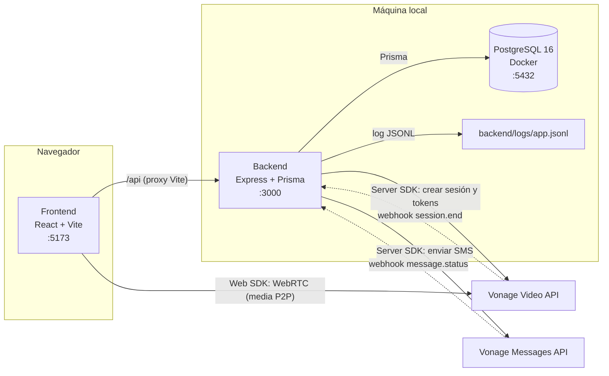
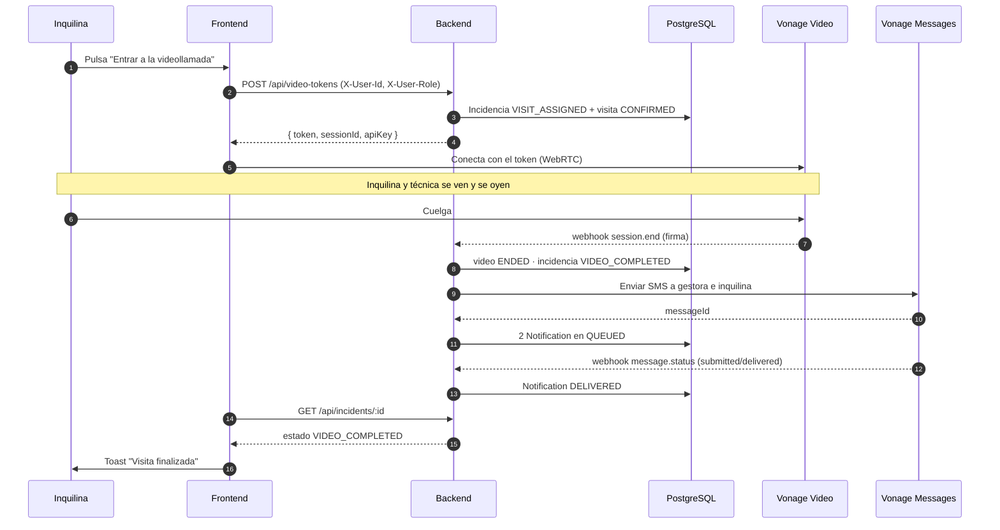

# ARCHITECTURE — Homefix Connect (v0)

> **Estado: v0 — provisional y viva.** Registra las decisiones ya tomadas, no las
> que nos gustaría tomar. Se actualiza **en el mismo PR** que introduce el cambio
> arquitectónico, no en un documento aparte.
>
> Última revisión: 2026-11-10 · Alcance: [`MVP_DEFINITION.md`](./MVP_DEFINITION.md)
> · Tareas: [`TASKS.md`](./TASKS.md) · Proceso: [`AGENTS.md`](../AGENTS.md)

---

## 1. Contexto

MVP demostrable en local: una incidencia ya reportada con visita asignada, una
**videollamada 1-a-1** entre inquilina y técnica (Vonage Video), y al colgar
**2 SMS** automáticos (Vonage Messages) a gestora y inquilina.

Restricciones que mandan sobre el diseño:

- **4 semanas** de plazo y 3 desarrolladoras a tiempo parcial.
- **Demo local**, sin despliegue en producción ni alta disponibilidad.
- **Backend-first**: el frontend es mínimo.
- Todo cambio lleva test; nada de infraestructura que no se vaya a demostrar.

---

## 2. Contenedores

**Lectura clave:** la **media** del vídeo no pasa por el backend (va por WebRTC
contra Vonage). El backend solo **crea la sesión, emite tokens y recibe
webhooks**.

---

## 3. Flujo principal

> Los paths definitivos los fija **T1** en `backend/openapi.yaml`. Este diagrama
> describe el flujo acordado, no congela URLs ni payloads.

---

## 4. Decisiones (ADR-lite)

### ADR-001 — Monorepo con pnpm workspaces

- **Contexto:** una sola demo con dos apps que comparten contrato y tipos.
- **Decisión:** un repositorio, dos workspaces (`backend/`, `frontend/`) y scripts
  orquestados desde la raíz.
- **Consecuencias:** un `pnpm install` y un `pnpm test` para todo; los PRs cruzan
  las dos capas con facilidad. A cambio, el lockfile es un punto de conflicto:
  nadie toca `package.json` en paralelo.

### ADR-002 — Docker solo para PostgreSQL

- **Contexto:** la demo es local y el tiempo es corto.
- **Decisión:** `docker-compose.yml` con **un único servicio** (`db`). Backend y
  frontend corren nativos con `pnpm dev`.
- **Consecuencias:** recarga en caliente y depuración sencillas. No hay paridad
  con un entorno de producción, que está fuera de alcance.

### ADR-003 — `prisma db push` en lugar de migraciones

- **Contexto:** 4 semanas, base local desechable, sin producción.
- **Decisión:** sincronizar el schema con `db push` y **no** versionar
  migraciones. `/prisma/migrations/` está ignorado en git.
- **Consecuencias:** cero fricción para iterar el modelo. Se pierde historial de
  cambios; cuando haya un entorno compartido, habrá que introducir migraciones.

### ADR-004 — Un único `.env` en la raíz

- **Contexto:** un archivo de entorno por workspace duplica variables y genera
  desincronización.
- **Decisión:** un `.env` en la raíz. El backend lo carga (`./.env` y `../.env`),
  Vite lo lee con `envDir: '..'` (solo `VITE_*`), y Prisma CLI lo carga con
  `dotenv-cli`.
- **Consecuencias:** un solo sitio que copiar de `.env.example`. Riesgo: exponer
  una variable de backend al frontend; se evita con el prefijo `VITE_`.

### ADR-005 — Logging a archivo JSONL, sin APM

- **Contexto:** se pidió observabilidad mínima, sin coste ni infraestructura.
- **Decisión:** `pino` escribiendo **JSONL** a `backend/logs/app.jsonl` (+ stdout
  en desarrollo). `pino-http` registra una línea por petición.
- **Consecuencias:** `tail`/`jq` bastan para depurar. No hay métricas, trazas
  distribuidas ni alertas.

### ADR-006 — OpenAPI como frontera entre capas

- **Contexto:** dos capas, tres personas, y tipos que se desincronizan.
- **Decisión:** `backend/openapi.yaml` es la fuente de verdad del contrato; el
  frontend consume tipos generados (`pnpm gen:types`, tarea **T1**) y no escribe
  interfaces a mano.
- **Consecuencias:** un cambio de contrato es visible y revisable. Mientras T1 no
  exista, `frontend/src/api/http.ts` es un cliente **provisional**.

### ADR-007 — Autenticación simulada por cabeceras

- **Contexto:** el login real está fuera de alcance y no aporta a la demo.
- **Decisión:** `X-User-Id` y `X-User-Role` (`TENANT` | `TECHNICIAN` | `MANAGER`),
  con los IDs fijos del seed:

  | Cabecera | Inquilina | Técnica | Gestora |
  |---|---|---|---|
  | `X-User-Id` | `usr_tenant_demo` | `usr_technician_demo` | `usr_manager_demo` |
  | `X-User-Role` | `TENANT` | `TECHNICIAN` | `MANAGER` |

  La demo abre **dos pestañas** del navegador: una como inquilina y otra como
  técnica. El rol se elige con un selector visible en la pantalla de la
  incidencia (no hay login ni almacenamiento de sesión).
- **Consecuencias:** se puede demostrar autorización por rol sin construir
  identidad. **No es seguridad real**: el backend confía en la cabecera.

### ADR-008 — TanStack Query como capa de datos del frontend

- **Contexto:** hay que reflejar el estado de la incidencia y refrescarlo tras el
  fin de la llamada.
- **Decisión:** todo acceso a la API pasa por `useQuery`/`useMutation`, con
  claves centralizadas (`['incident', id]`, `['health']`).
- **Consecuencias:** caché, reintentos y estados de carga gratis. A cambio, hay
  que respetar un patrón y no mezclar `fetch` suelto.

### ADR-009 — SDK de Vonage: servidor en backend, Web SDK en frontend

- **Contexto:** el secreto de la aplicación solo puede vivir en el servidor.
- **Decisión:** el backend crea la sesión y firma los tokens; el frontend solo
  recibe un token efímero y abre WebRTC.
- **Consecuencias:** el secreto nunca llega al navegador. Los tokens caducan:
  hay que pedir uno nuevo por sesión.

### ADR-010 — Modelo de datos v0 y seed determinista

- **Contexto:** el modelo no está cerrado y el equipo debe poder levantarlo hoy.
- **Decisión:** 5 entidades mínimas (`User`, `Incident`, `Visit`, `VideoSession`,
  `Notification`) con IDs fijos en el seed (`inc_demo`, `visit_demo`, `vs_demo`).
  Los **teléfonos de destino de los SMS salen de `User.phone` en la base de
  datos**, no de variables de entorno: una sola fuente de verdad. `.env` solo
  guarda credenciales y configuración de Vonage.
- **Consecuencias:** el frontend y los tests tienen datos estables. El schema se
  refina en el PR de cada tarea; los IDs fijos no se cambian sin actualizar seed,
  tests y frontend. Cambiar un destinatario de la demo es editar el seed, no el
  `.env`.

### ADR-011 — Node 24 y pnpm 12 fijados

- **Contexto:** tres máquinas y un CI; las versiones distintas rompen el lockfile.
- **Decisión:** `.nvmrc` (24), `engines.node >= 24`, `packageManager` con pnpm
  exacto y `corepack`.
- **Consecuencias:** entorno reproducible. Quien tenga otra versión debe
  cambiarla, no "hacer que funcione".

### ADR-012 — Sin colas ni Redis: SMS síncrono con estado en BD

- **Contexto:** son 2 SMS por visita en una demo local.
- **Decisión:** el webhook `session.end` envía los SMS en la misma petición y
  persiste el estado en `Notification`.
- **Consecuencias:** menos piezas y menos fallos. Si Vonage tarda o falla, la
  petición tarda o registra `FAILED`; no hay reintento automático (ver §7).

---

## 5. Seguridad

| Tema | Decisión actual |
|---|---|
| Secretos | `.env` fuera de git; `private.key` ignorado; nunca en logs |
| Webhooks | Validación de firma **antes** de procesar (tarea **X3**) |
| Autorización | Headers simulados; el endpoint valida que el rol pueda entrar |
| Tokens de vídeo | Cortos, generados en backend, uno por participante |
| Datos personales | Solo IDs en logs; teléfonos nunca completos |
| CORS | Abierto en local; sin despliegue público |

## 6. Observabilidad

- **Qué:** peticiones HTTP, eventos de negocio (sesión creada, token emitido,
  SMS encolado/entregado/fallido, webhook recibido y validado/ rechazado), errores.
- **Dónde:** `backend/logs/app.jsonl`, una línea JSON por evento.
- **Cómo se consulta:** `tail -f`, `jq`, `grep`.
- **Fuera de alcance:** métricas, trazas, dashboards, alertas.

## 7. Pendiente de decidir (no inventar antes de tiempo)

| Tema | Se decide en |
|---|---|
| Contrato exacto de endpoints y payloads | **T1** (`openapi.yaml`) |
| Forma de los services (clases vs funciones, inyección) | **A1/A2** |
| Idempotencia de webhooks (dedupe por `messageId`/`sessionId`) | **A4/B4** |
| Reintentos de SMS y fallback si Vonage falla | **B3/B5** |
| Rate limiting y validación de origen de webhooks | **I2** |
| Reconexión de vídeo y cierre ordenado de la UI | **C4/I2** |
| ¿Router en el frontend o una sola pantalla? | **C2** |
| Migraciones de Prisma (cuando exista entorno compartido) | Post-MVP |

## 8. Riesgos

| Riesgo | Impacto | Mitigación |
|---|---|---|
| Credenciales o números de Vonage no verificados | Bloquea SMS y vídeo reales | Verificar cuentas en la semana 1 |
| URL de ngrok cambia | Los webhooks no llegan | Actualizar `WEBHOOK_BASE_URL` y el dashboard de Vonage |
| Conflicto en `pnpm-lock.yaml` | Bloquea PRs | Un solo PR tocando dependencias a la vez |
| El modelo v0 se queda corto | Retrabajo | Refinar en el PR que lo necesite, no antes |
| Schema y contrato divergen del código | Tests mentirosos | Actualizar `openapi.yaml`/`schema.prisma` en el mismo PR |
| La demo depende de la red | Falla en directo | Ensayo completo en la semana 3 (I1) |
