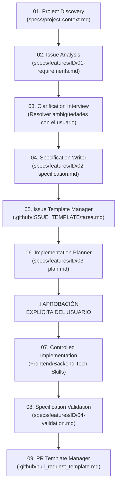

# Guía del Framework SDD (Spec-Driven Development)

> **Spec-Driven Development (SDD)** es la metodología central de Homefix Connect: ningún código se escribe sin una especificación formal aprobada, y ningún cambio se mergea sin pruebas verdes y criterios de aceptación verificados.

Esta guía documenta el flujo operativo de 9 fases implementado a través de **skills modulares** en el directorio `skills/` para desarrolladoras y asistentes de IA.

---

## 1. El Flujo de Trabajo en 9 Fases



---

## 2. Mapa de Skills SDD en `skills/`

| Fase | Skill | Propósito | Artefacto Generado / Actualizado |
|---|---|---|---|
| **01** | `sdd-01-project-discovery` | Entender el contexto global, arquitectura, dominio y código | `specs/project-context.md` |
| **02** | `sdd-02-issue-analysis` | Diseccionar el issue, caso de uso del MVP y límites de alcance | `specs/features/<ID>/01-requirements.md` |
| **03** | `sdd-03-requirements-clarification` | Conducir entrevista con el usuario; resolver dudas críticas | `specs/features/<ID>/01-requirements.md` |
| **04** | `sdd-04-specification-writer` | Redactar contratos entrada/salida, errores y Given/When/Then | `specs/features/<ID>/02-specification.md` |
| **05** | `sdd-05-issue-template-manager` | Trasladar la especificación a la plantilla de issue de GitHub | `.github/ISSUE_TEMPLATE/tarea.md` |
| **06** | `sdd-06-implementation-planner` | Plan técnico: ficheros afectados, orden TDD y mitigación de riesgos | `specs/features/<ID>/03-plan.md` |
| **07** | `sdd-07-implementation` | Codificar solo lo aprobado aplicando skills técnicas de front/back | Código fuente + tests unitarios |
| **08** | `sdd-08-specification-validation` | Ejecutar `pnpm check`, `pnpm test` y verificar criteria de aceptación | `specs/features/<ID>/04-validation.md` |
| **09** | `sdd-09-pr-template-manager` | Generar la descripción completa del PR con comandos y evidencias | `.github/pull_request_template.md` |

---

## 3. Conexión con las Skills Técnicas (Fase 07)

Durante la implementación (`sdd-07-implementation`), el agente activa y aplica automáticamente las skills locales según la capa modificada:

### Si la tarea afecta al Frontend:
- **`frontend-dev-guidelines`**: Organización en `components/` vs `hooks/`, consumo exclusivo mediante **TanStack Query** y TypeScript estricto.
- **`vercel-react-best-practices`**: Eliminación de waterfalls asíncronos (`Promise.all`), `React.lazy` para componentes pesados y limpieza obligatoria en `useEffect`.
- **`react-best-practices`**: Composición limpia mediante `props` y `children`, custom hooks reutilizables sin JSX y flujo de estado predecible.

### Si la tarea afecta al Backend:
- **`nodejs-backend-patterns`**: Arquitectura en capas (`routes/` delegadas, `services/` puros, `db/` Prisma singleton), ESM con imports `.js` y observabilidad con Pino.
- **`architecture-patterns`**: Principios de Clean Architecture y Hexagonal para que los servicios se puedan testear sin levantar Express ni Postgres.
- **`error-handling-patterns`**: Excepciones de dominio tipadas, captura centralizada en `errorHandler` y formato estándar `{ "error": "mensaje" }`.

---

## 4. Estructura de Artefactos en `specs/`

Para cada tarea o issue trabajado, se mantiene la trazabilidad dentro de `specs/`:

```text
specs/
├── project-context.md          # Visión global del proyecto (arquitectura, stack, use cases)
└── features/
    └── <ID-tarea>-<slug>/
        ├── 01-requirements.md   # Análisis del problema, clasificación y entrevista
        ├── 02-specification.md  # Especificación formal con contratos y acceptance criteria
        ├── 03-plan.md           # Plan de implementación paso a paso (TDD)
        └── 04-validation.md     # Registro de comandos reales (pnpm test, check, curl)
```

---

## 5. Instrucciones Rápidas de Uso para el Usuario

### ¿Cómo iniciar el flujo con una nueva tarea?
Pide al agente:
> *"Quiero trabajar en la tarea A3 de docs/TASKS.md. Usa el flujo SDD empezando por el análisis del issue y la clarificación de requisitos."*

El agente ejecutará:
1. `sdd-02-issue-analysis` para mapear el caso de uso y dependencias.
2. `sdd-03-requirements-clarification` y te formulará preguntas concisas con alternativas sobre campos, validaciones o errores.
3. Tras tus respuestas, generará la especificación (`sdd-04`) y el issue completado (`sdd-05`).
4. Propondrá el plan técnico (`sdd-06`) y se detendrá pidiendo tu aprobación.
5. Tras tu aprobación ("Adelante"), ejecutará la implementación (`sdd-07`), la validación de tests (`sdd-08`) y te entregará el texto listo para el PR (`sdd-09`).
